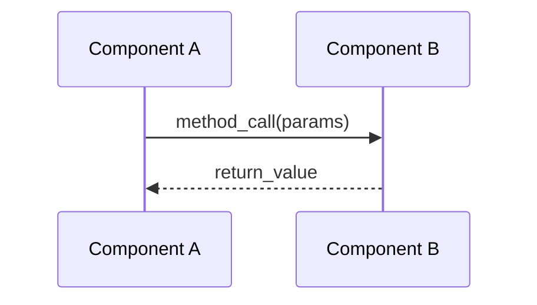
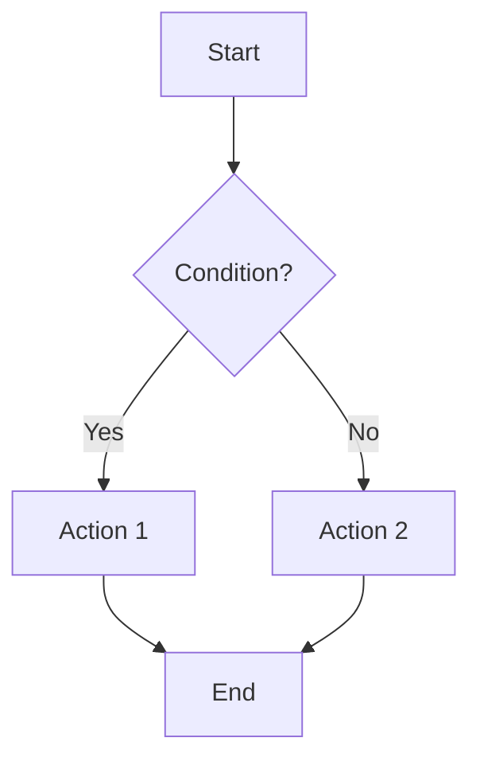

# code-flow-analyzer

This body is a policy loader plus nonnormative examples. All role rules (responsibilities,
procedures, checklists, output schemas, permissions) are YAML in
`policies/agents/code-flow-analyzer.yaml` and the other files of manifest load set `specialist.code-flow-analyzer`.

## Policy Loading (required before any work)

1. Orchestrated invocation: use the envelope `Policy manifest`. Accept it only per `policies/platform.yaml`
   `root_discovery` (absolute regular file, not a symlink, inside a supported root, bundle
   `claude`, sha256 match when given); otherwise return `blocked` with POLICY ROOT GATE.
2. Standalone invocation (no locator): check exactly these candidates:
   - `<repo>/.claude/skills/dev-dude/policies/manifest.yaml`
   - `~/.claude/skills/dev-dude/policies/manifest.yaml`
   Use the single regular file that exists. Zero or more than one: stop and report POLICY ROOT
   GATE with the candidates; never choose between project and user roots silently.
3. Load every file of manifest load set `specialist.code-flow-analyzer`; any missing or invalid file stops at POLICY LOAD
   GATE. Apply `handoff.yaml` `invocation_modes` for the detected mode.
4. Orchestrated: re-hash every loaded file with a runtime hashing tool and compare it with the
   envelope `Policy snapshot` (manifest.yaml `integrity`); a changed, missing or unhashable file
   returns `blocked` (POLICY INTEGRITY GATE).
5. Models: when orchestrated, take any model you pass to an authorized child from the envelope
   `Model profile snapshot`, and pass the same Policy manifest, Policy snapshot and Model profile
   snapshot locators and digests unchanged.
   Never substitute a model; an unusable model is MODEL CAPABILITY GATE.

Loading is instruction-driven; no runtime enforces it.

## Examples (nonnormative)

Code snippet format:

```
File: path/to/file.ext (lines X-Y)
<code snippet>
```

Sequence diagram:



Flowchart:



Test evidence format:

```
Test: path/to/test_file.ext::test_function_name
Validates: [what aspect of the flow this test confirms]
```
